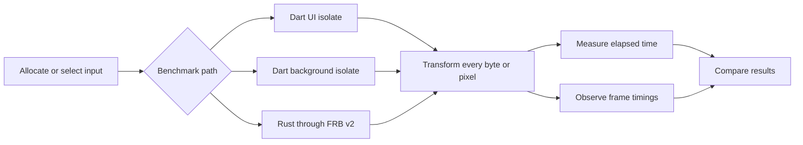

# Flutter + Rust Performance Benchmark

## Presentation Summary

This project demonstrates how the execution location of a CPU-heavy pixel workload affects Flutter performance.

The same work is compared across:

1. Pure Dart on the Flutter UI isolate.
2. Dart `compute()` on a background isolate.
3. Rust called asynchronously through `flutter_rust_bridge` v2.

The benchmark uses both synthetic buffers and a real gallery image. The real-image test is the most tangible scenario because it includes decoding a photo into RGBA pixels and processing every pixel.

## Core Finding

For large pixel workloads, Rust provides the best processing throughput. Dart isolates protect the UI isolate from the pixel loop, but large input/output transfers can dominate total duration. FRB v2 provides asynchronous native execution, but passing a full `Vec<u8>` through the bridge is not zero-copy.

True zero-copy behavior requires keeping the large buffer outside Dart and returning only metadata, a native texture, or another native-owned handle.

## Experiment Flow



### Synthetic dashboard flow

1. Select a payload size: 50 MB or 500 MB.
2. Select a workload: byte inversion or RGBA frame processing.
3. Reset the frame counter.
4. Prepare the buffer outside the timed benchmark window.
5. Run one of the three execution paths.
6. Record elapsed time and frame impact.
7. Repeat on the same device and build mode.

### Real-image flow

1. Pick a photo from the gallery.
2. Decode it into raw RGBA pixels.
3. Run the same multi-stage pixel transform through Dart UI, Dart isolate, or Rust.
4. Reconstruct the processed RGBA buffer as a displayable Flutter image.
5. Compare processing time with output-render cost.
6. Inspect the before/after image and the timing cards.

## Workloads

### Byte inversion

Each byte is replaced with `255 - value`. This is a simple memory-bandwidth baseline.

### RGBA frame pipeline

Each four-byte pixel undergoes:

- Luminance calculation.
- Multi-channel tone transformation.
- Alpha normalization.
- In-place writes back to the RGBA buffer.

The same pixel algorithm is implemented in Dart and Rust so the execution-path comparison is meaningful.

### Real image size

The compressed file size is not the processing size. A `5760 × 3240` image contains:

- 18.66 million pixels.
- Approximately 74.6 MB of raw RGBA data.
- Additional temporary memory for copies, bridge buffers, image objects, and GPU resources.

A nominal 16K image at `15360 × 8640` contains 132.7 million pixels and requires approximately 506 MiB for one raw RGBA buffer. Several simultaneous buffers can exceed a phone's memory budget.

## Execution Paths

### Method A: Dart UI thread

```text
Flutter UI isolate -> synchronous Dart loop -> result
```

This is the intentionally blocking baseline. While the loop executes, the UI isolate cannot build frames, respond to input, or advance the spinner.

### Method B: Dart isolate

```text
UI isolate -> copy/transfer input -> Dart isolate -> copy/transfer result -> UI isolate
```

The pixel loop runs away from the UI isolate. However, the large buffer still has to cross isolate boundaries. This improves responsiveness but does not guarantee lower total elapsed time.

### Method C: Rust through FRB v2

```text
UI isolate -> FRB async call -> Rust Vec<u8> processing -> Vec<u8> response -> UI isolate
```

Rust is effective for the native loop, but the real-image `Vec<u8>` API still transfers a large buffer across the Dart/native boundary. This path is asynchronous, but it is not zero-copy.

### Rust-owned metadata path

The synthetic benchmark also includes a Rust-owned path:

```text
Rust allocates and processes buffer -> Dart receives checksum and timing only
```

This isolates native processing performance from Dart buffer-transfer costs and is the closest implementation in the project to a zero-copy design.

## Instrumentation

The app uses `WidgetsBinding.instance.addTimingsCallback` to observe Flutter frame timing batches.

It reports:

- Current FPS.
- Display refresh target.
- Total dropped frame slots.
- A green/red jank status indicator.
- Per-method frame impact.
- Separate pixel-processing and output-render impact on the real-image page.

The spinner is continuously animated. It visually stops or becomes visibly delayed when the UI isolate is blocked.

The real-image page keeps two phases separate:

1. **Pixel processing:** Dart loop, isolate work, or FRB call and transfer.
2. **Output render:** reconstruction and presentation of the processed image.

Android can deliver `FrameTiming` callbacks after the blocking work has returned. The page therefore keeps each phase armed briefly to drain delayed timing batches. For the synchronous UI path, the processing frame count is stabilized from the measured blocking duration so repeated runs do not overcount delayed batches.

## Observed Results

### Nokia 8.1, release mode, `5760 × 3240` image

The following values came from repeated runs on the same real device. They are representative ranges, not laboratory averages.

| Method | Observed time | Main interpretation |
|---|---:|---|
| Dart UI thread | 305–308 ms | Consistently blocks the UI isolate. |
| Dart background isolate | 398–418 ms | Pixel loop is offloaded, but isolate input/output transfer is expensive. |
| Rust FRB v2 | 162–196 ms | Fastest processing path, but still includes FRB `Vec<u8>` transfer. |

Indicatively, Rust was about 1.7× faster than synchronous Dart and about 2.2× faster than the Dart isolate on this device.

### Earlier device comparison

An earlier run of the same resolution on a faster device produced approximately:

| Method | Observed time |
|---|---:|
| Dart UI thread | 74.8 ms |
| Dart isolate | 85.6 ms |
| Rust FRB v2 | 34.5 ms |

These numbers should not be compared directly with Nokia 8.1 results. CPU, memory bandwidth, OS scheduling, Flutter build mode, and thermal state all affect absolute timings.

### Synthetic 500 MB workload

After optimizing the Rust implementation and running an optimized build, one representative run showed approximately:

| Method | Observed time |
|---|---:|
| Dart UI thread | 331 ms |
| Dart isolate | 525 ms |
| Rust-owned path | 161 ms |

An earlier multi-second Rust result was caused by an unoptimized implementation/build and should not be used as a final benchmark result.

## What the Results Prove

### 1. UI-thread work blocks Flutter

The synchronous Dart method has the clearest causality: the spinner pauses and the frame monitor reports a large processing impact. This is the correct demonstration of why heavy loops do not belong on the UI isolate.

### 2. An isolate solves scheduling, not data movement

`compute()` is useful when the priority is keeping the UI responsive. It may still be slower than synchronous Dart because a large buffer must be transferred into the isolate and the result must return.

### 3. Rust improves compute throughput

The Rust loop is consistently the fastest path in the real-image tests. This is especially visible on the Nokia 8.1, where Rust is roughly twice as fast as the Dart isolate path.

### 4. FRB is asynchronous, not automatically zero-copy

The API signature `Vec<u8> -> Vec<u8>` communicates ownership across the bridge. It does not mean Dart and Rust are directly sharing the same byte array. The bridge and runtime still have to marshal or transfer the data.

### 5. End-to-end image performance has another bottleneck

Even when pixel processing is smooth, reconstructing and presenting a large processed image can create memory and GPU pressure. This is why the real-image page reports output rendering separately.

### 6. Memory pressure increases across repeated runs

Repeated large-image runs can trigger Dart garbage collection, native image cleanup, and GPU resource reclamation. This explains why output-render measurements vary more than the core Rust loop time.

## Performance Improvements Implemented

- Added Rust in-place byte inversion.
- Added Rust RGBA pixel processing with the same algorithm as Dart.
- Added Rust-owned metadata-only benchmarks to avoid returning huge buffers.
- Enabled FRB v2 code generation with `--full-dep`.
- Added `CST/DCO` support for large `Vec<u8>` experiments.
- Moved large buffer preparation outside the timed benchmark window.
- Added 50 MB and 500 MB synthetic payload modes.
- Added byte-inversion and RGBA workloads.
- Added real gallery-image processing.
- Added separate processing and output-render metrics.
- Added frame timing and spinner instrumentation.
- Added release/profile guidance for real-device testing.
- Corrected the UI method label to `DART UI THREAD`.
- Removed `TransferableTypedData` from the final demo because its measured path was slower and made the main story less clear.
- Kept the original full-buffer Rust API available for round-trip experiments.

## Benchmark Caveats

The timing cards do not measure identical boundaries:

- Dart UI timing primarily measures the synchronous pixel loop.
- Dart isolate timing includes isolate input/output transfer.
- Rust FRB timing includes the async bridge round-trip for `Vec<u8>`.
- Real-image output reconstruction is measured separately.

Therefore, the results are best described as **practical execution-path comparisons**, not pure kernel benchmarks.

For credible comparisons:

1. Use the same physical device.
2. Use profile or release mode.
3. Warm up each method once.
4. Run several iterations.
5. Report median or representative ranges.
6. Keep payload dimensions and workload identical.
7. Record whether the result includes transfer and output presentation.

## Recommended Final Conclusion

> Rust provides the best processing throughput for large pixel workloads. Dart isolates are valuable for protecting Flutter's UI isolate, but large buffer transfers can dominate total duration. `flutter_rust_bridge` v2 enables asynchronous native execution, but a full `Vec<u8>` round-trip is not zero-copy. For the best end-to-end architecture, keep large buffers Rust-owned and return only metadata, a native texture, or a native buffer handle.

## Slide-Ready Outline

### Slide 1: The question

**Where should a heavy pixel workload run in a Flutter app?**

- UI isolate
- Dart background isolate
- Rust through FRB v2

### Slide 2: The workload

- Real photo: `5760 × 3240`
- 18.66 million pixels
- Approximately 74.6 MB decoded RGBA
- Multiple arithmetic operations per pixel

### Slide 3: The three paths

- Synchronous Dart: simplest, blocks frames
- `compute()`: responsive UI, transfer overhead
- Rust FRB: faster native processing, bridge transfer remains

### Slide 4: Nokia 8.1 results

```text
Dart UI thread       305–308 ms
Dart isolate         398–418 ms
Rust FRB v2          162–196 ms
```

### Slide 5: What the numbers mean

- Rust is approximately 1.7× faster than Dart UI processing.
- Rust is approximately 2.2× faster than the Dart isolate path.
- Isolates improve scheduling, not necessarily elapsed time.

### Slide 6: The zero-copy lesson

- `Vec<u8>` through FRB is a transfer boundary.
- Native processing can be fast while end-to-end transfer remains expensive.
- Rust-owned buffers plus metadata are the closest zero-copy design.

### Slide 7: Memory reality

- 16K RGBA is approximately 506 MiB for one buffer.
- Source, copy, output, decoder, and GPU resources multiply peak memory.
- Large images can crash mobile apps even when the algorithm is efficient.

### Slide 8: Final recommendation

- Use Dart UI only for small workloads.
- Use a Dart isolate when responsiveness is the primary goal and transfers are manageable.
- Use Rust for compute-heavy native processing.
- Keep large buffers native-owned when transfer cost matters.

## Reproduction Commands

```bash
flutter pub get
flutter_rust_bridge_codegen generate --full-dep

# Physical Android/iOS device or desktop
flutter run --profile -d <device-id>
# or
flutter run --release -d <device-id>
```

For final benchmark reporting, use a physical device in profile or release mode. iOS simulator release/profile execution is restricted; simulator runs are useful for interaction testing but not final performance claims.
